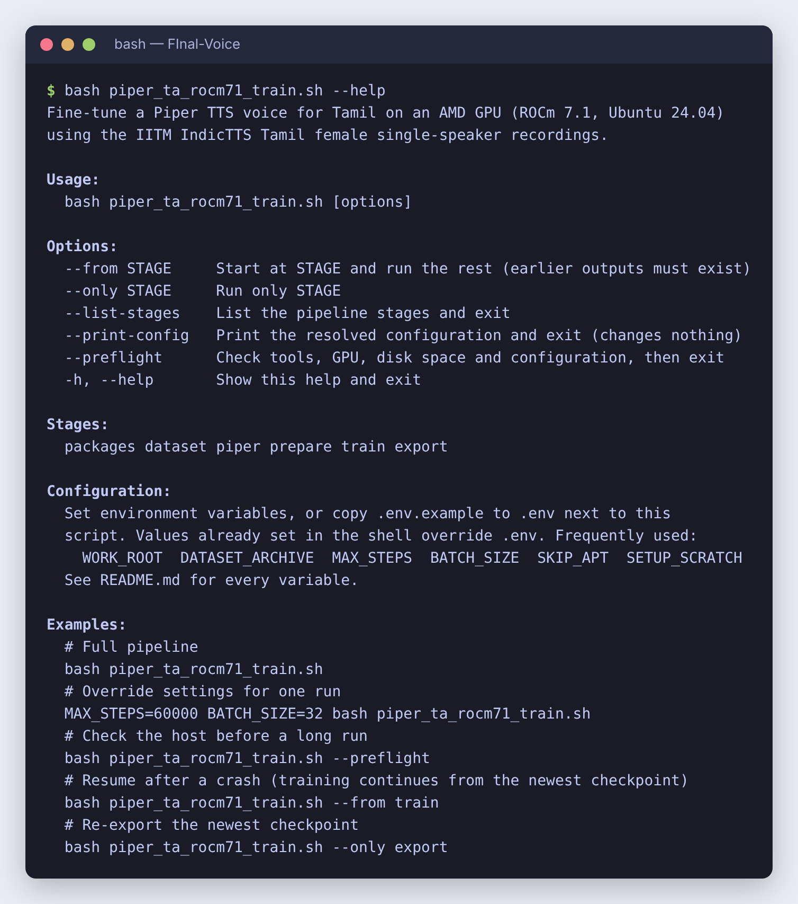
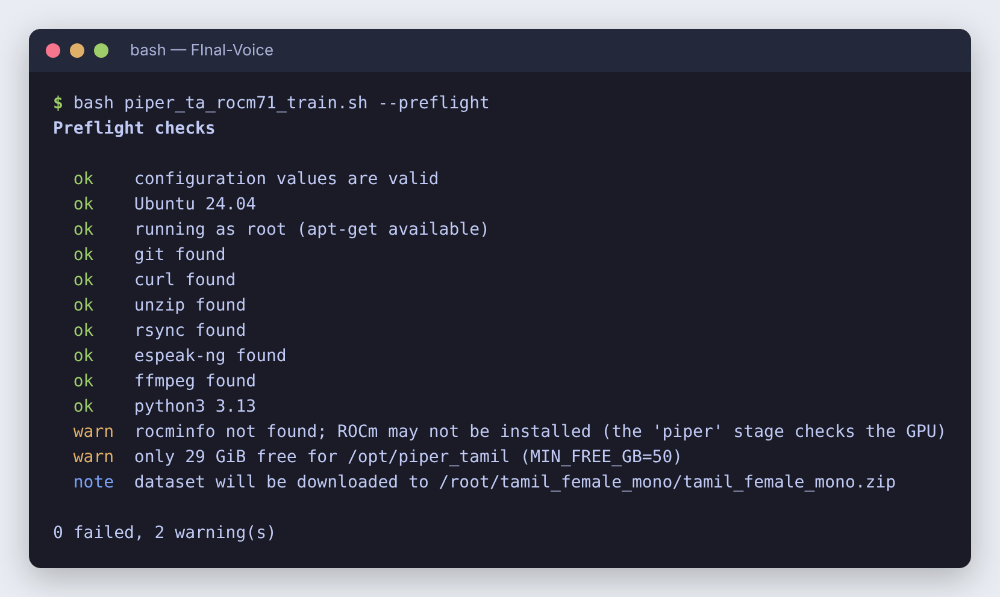
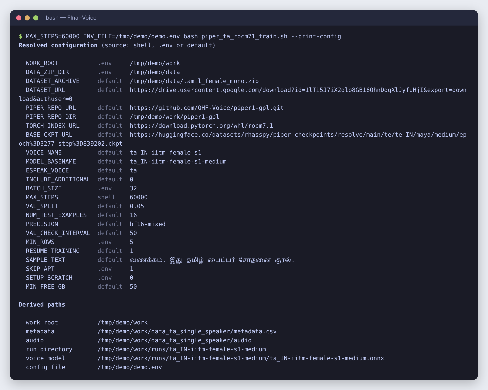
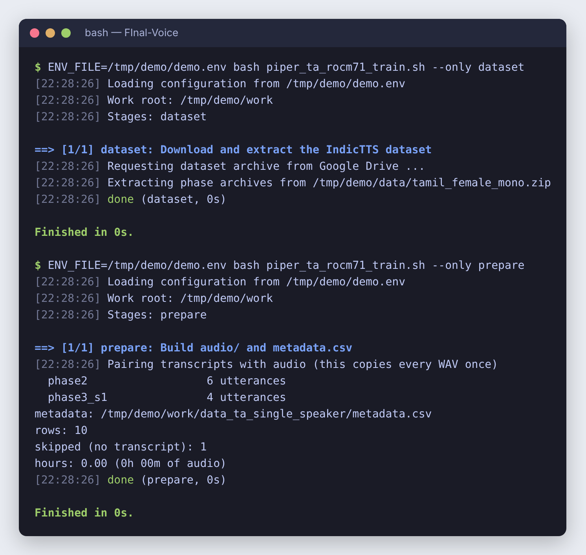
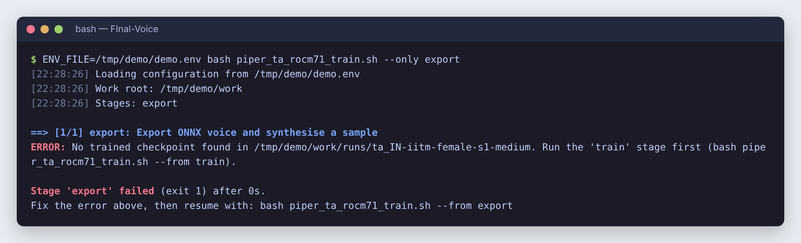
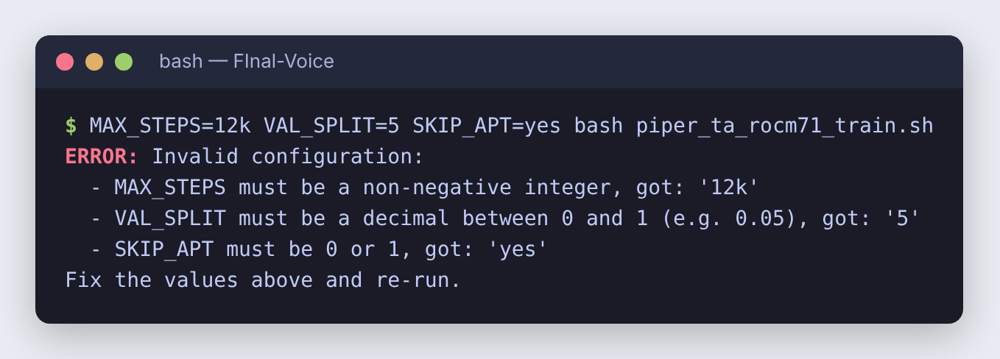
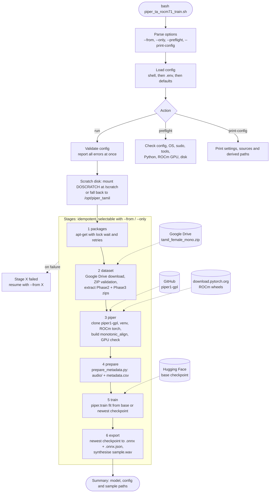
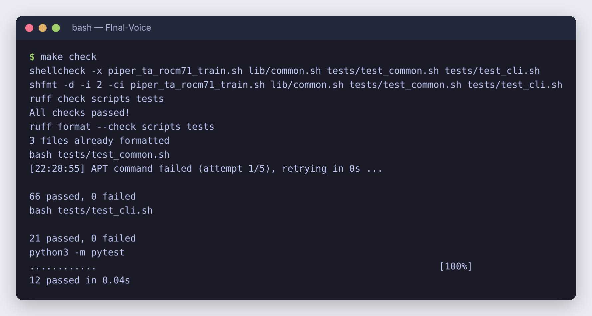

# Piper Tamil TTS Trainer for AMD ROCm

**One resumable command that turns an Ubuntu 24.04 server with an AMD GPU into a
trained Tamil text-to-speech voice for [Piper](https://github.com/OHF-Voice/piper1-gpl).**


```bash
git clone https://github.com/jeevithg090/FInal-Voice.git
cd FInal-Voice
bash piper_ta_rocm71_train.sh --preflight   # check the machine
bash piper_ta_rocm71_train.sh               # train the voice
```

---

## Contents

- [Overview](#overview)
- [Screenshots](#screenshots)
- [Features](#features)
- [Tech stack](#tech-stack)
- [Architecture](#architecture)
- [Project structure](#project-structure)
- [Prerequisites](#prerequisites)
- [Installation](#installation)
- [Configuration](#configuration)
- [Usage](#usage)
- [Command-line reference](#command-line-reference)
- [Outputs and using the voice](#outputs-and-using-the-voice)
- [Development: scripts, tests and linting](#development-scripts-tests-and-linting)
- [Deployment](#deployment)
- [Troubleshooting and FAQ](#troubleshooting-and-faq)
- [Known limitations](#known-limitations)
- [Roadmap ideas](#roadmap-ideas)
- [Contributing](#contributing)
- [License](#license)
- [Acknowledgements](#acknowledgements)

## Overview

Piper is a fast, local, offline text-to-speech engine, but it has no
ready-made Tamil voice and its training tooling assumes NVIDIA/CUDA. Getting a
Tamil voice trained on an AMD GPU means stitching together a dozen manual
steps: system packages, a ROCm build of PyTorch, Piper's native extension,
downloading a multi-gigabyte corpus from Google Drive, converting Festival
transcripts into Piper's metadata format, picking a pretrained checkpoint,
running Lightning, and exporting to ONNX.

This repository does all of that with one script. It fine-tunes Piper's
pretrained Telugu *maya* medium checkpoint on the IIT Madras **IndicTTS**
Tamil female single-speaker recordings using PyTorch on **ROCm 7.1**, then
exports an ONNX voice and synthesises a sample WAV.

**Who it is for:** anyone with access to an AMD GPU machine (for example a
cloud AMD Instinct instance) who wants a Tamil Piper voice without
hand-assembling the training pipeline: hobbyists, accessibility and
assistive-tech developers, and researchers who want a reproducible baseline.

The project has no web interface; it is a command-line training pipeline. Its
"user interface" is the terminal output, `--help`, `--preflight` and
`--print-config`, shown below.

## Screenshots

All screenshots are real terminal output from this repository's script,
captured in a development container (no GPU) with a small synthetic,
IndicTTS-shaped demo dataset. No personal data is shown.

**`--help`: usage, stages and examples**



**`--preflight`: checks the host without changing anything.** The container
has no ROCm and a small disk, so those two checks warn.



**`--print-config`: every resolved setting and where it came from**



**Running individual stages** (`dataset` and `prepare` on the demo dataset)



**When something fails** the script names the stage and prints the command to resume



**Invalid settings are all reported at once**, before anything runs



## Features

- **One command, end to end**: system packages, dataset download, Piper
  install, dataset preparation, training, ONNX export and a sample WAV.
- **Named stages you can resume or rerun**: `--from train` resumes after a
  crash, `--only export` re-exports the newest checkpoint, `--list-stages`
  shows them all. Each stage prints a numbered banner and its duration.
- **Training resumes from the newest checkpoint** instead of starting over
  from the base model (`RESUME_TRAINING=1`, the default).
- **Preflight check** (`--preflight`): configuration, OS, root/sudo, required
  tools, Python version, ROCm GPU visibility (`rocminfo`) and free disk space,
  with `ok` / `warn` / `note` / `FAIL` rows and a non-zero exit on failures.
- **Configuration inspector** (`--print-config`): every setting, its value,
  and whether it came from the shell, `.env` or the default, plus all derived
  output paths.
- **Early, complete validation**: numeric settings, flags, `VAL_SPLIT` and
  `PRECISION` are checked before any work starts, and every problem is listed
  at once.
- **Actionable errors**: a failed stage prints `resume with: bash
  piper_ta_rocm71_train.sh --from <stage>`; missing prerequisites say which
  stage to run first.
- **Resumable, validated downloads**: an interrupted dataset download resumes
  from its `.part` file; a corrupted archive is detected (magic bytes plus
  `unzip -t`) and re-downloaded; the base checkpoint is renamed into place only
  when complete.
- **Google Drive large-file support**: handles both direct downloads and the
  "can't scan for viruses" confirmation page (`confirm` + `uuid` tokens).
- **Robust on fresh cloud servers**: waits for and retries around
  `apt`/`dpkg` locks held by `unattended-upgrades`; optionally mounts a
  `DOSCRATCH`-labelled scratch volume at `/scratch`.
- **Fine-tuning that does what you mean**: the base checkpoint is already at
  global step 839,202, so a `MAX_STEPS` at or below that is treated as
  *additional* steps instead of stopping immediately.
- **Safe configuration file**: `.env` is parsed literally (never `source`d),
  so it cannot run code, and it never overrides values already set in the
  shell.
- **Readable output**: colour on terminals only, honouring
  [`NO_COLOR`](https://no-color.org) and plain output when piped or logged.
- **Tested without a GPU**: 66 shell assertions, 21 CLI checks and 12 pytest
  tests, plus ShellCheck, shfmt and Ruff.

## Tech stack

| Layer | Technology | Where |
| --- | --- | --- |
| Orchestration | Bash 5 (`set -euo pipefail`) | `piper_ta_rocm71_train.sh`, `lib/common.sh` |
| Dataset preparation | Python 3.10+ standard library only | `scripts/prepare_metadata.py` |
| TTS model | [Piper](https://github.com/OHF-Voice/piper1-gpl) (VITS) on PyTorch Lightning | cloned at run time |
| GPU runtime | PyTorch ROCm 7.1 wheels | `TORCH_INDEX_URL` |
| Phonemisation | eSpeak NG (`ta` voice) | apt package |
| Base model | `rhasspy/piper-checkpoints` `te_IN/maya/medium` | Hugging Face |
| Export / inference | ONNX, ONNX Runtime | `piper.train.export_onnx`, `python -m piper` |
| Monitoring | TensorBoard | Piper venv |
| Dev tooling | ShellCheck, shfmt, Ruff, pytest, Make | `pyproject.toml`, `Makefile` |

## Architecture

The entry script loads configuration, validates it, resolves the working
directory, and then runs six idempotent stages. `lib/common.sh` holds the
side-effect-free helpers that the stages call (and that the tests exercise
directly). `scripts/prepare_metadata.py` is the only Python the pipeline runs
itself; everything else is Piper's own tooling.



### Dataset preparation in detail

`scripts/prepare_metadata.py` reads the Festival-format `txt.done.data`
transcripts inside each IndicTTS archive (`( utt_id "text" )`), pairs each
transcript with the WAV file of the same name, normalises whitespace, removes
the `|` field delimiter from text, streams the audio into `audio/<source>/`,
and writes Piper's `relative/path.wav|text` metadata. Utterances without a
transcript are skipped and counted, per-source counts are printed, and the run
aborts if fewer than `MIN_ROWS` (default 3000) utterances are found.

| Archive | Members used | Output folder |
| --- | --- | --- |
| `IndicTTS_Phase2_Tamil_fem_Speaker1_mono.zip` | `mono/Read_speech/txt.done.data`, `mono/Read_speech/wav/*.wav` | `audio/phase2/` |
| `IndicTTS_Phase3_Tamil_fem_Speaker1_mono.zip` | `speaker1/txt.done.data`, `speaker1/wav/*.wav` | `audio/phase3_s1/` |
| Phase 2 (only with `INCLUDE_ADDITIONAL=1`) | `mono/Additional_data/all_bi_mono_sus_text.txt`, `mono/Additional_data/wav/*.wav` | `audio/phase2_additional/` |

### Directory layout at run time

```
$DATA_ZIP_DIR/                         # default: $HOME/tamil_female_mono
├── tamil_female_mono.zip              # outer archive (downloaded or placed by you)
├── IndicTTS_Phase2_Tamil_fem_Speaker1_mono.zip
└── IndicTTS_Phase3_Tamil_fem_Speaker1_mono.zip

$WORK_ROOT/                            # default: /scratch/piper_tamil, else /opt/piper_tamil
├── piper1-gpl/                        # Piper checkout + .venv (PyTorch ROCm, Lightning, ...)
├── data_ta_single_speaker/
│   ├── raw/                           # copies of the phase zips
│   ├── audio/phase2/, audio/phase3_s1/
│   └── metadata.csv                   # relative/path.wav|text
└── runs/<MODEL_BASENAME>/
    ├── base.ckpt                      # downloaded base checkpoint
    ├── cache/                         # Piper's phoneme/audio cache
    ├── lightning_logs/version_N/      # checkpoints + TensorBoard events
    ├── train_YYYYmmdd_HHMMSS.log      # full training log per run
    ├── <MODEL_BASENAME>.onnx          # exported voice
    ├── <MODEL_BASENAME>.onnx.json     # Piper voice config
    └── sample.wav                     # synthesised SAMPLE_TEXT
```

## Project structure

```
.
├── piper_ta_rocm71_train.sh     # Entry point: option parsing, config, preflight, the six stages
├── lib/
│   └── common.sh                # Sourced helpers: logging/colours, validators, apt retries,
│                                #   ZIP checks, Google Drive download, step maths,
│                                #   latest-checkpoint lookup, safe .env loader
├── scripts/
│   └── prepare_metadata.py      # IndicTTS archives -> audio/ + Piper metadata.csv (stdlib only)
├── tests/
│   ├── test_common.sh           # Unit tests for lib/common.sh (incl. stubbed-curl downloads)
│   ├── test_cli.sh              # CLI tests: options, validation, --print-config, --preflight
│   ├── test_prepare_metadata.py # pytest on synthetic IndicTTS-shaped archives
│   └── conftest.py              # puts scripts/ on sys.path
├── docs/
│   └── screenshots/             # Real terminal captures used in this README
├── .env.example                 # Every configuration variable with its default
├── Makefile                     # lint / format / test / check
├── pyproject.toml               # Dev dependencies + Ruff and pytest config
├── .editorconfig                # Indentation and line-ending rules
└── .gitignore
```

## Prerequisites

**To train a voice:**

| Requirement | Notes |
| --- | --- |
| Ubuntu 24.04 | Other distributions are untested; `--preflight` warns. |
| AMD GPU supported by ROCm 7.1, with the ROCm driver stack installed | The `piper` stage stops if PyTorch cannot see the GPU. `rocminfo` should list a `gfx…` agent. |
| Root or passwordless `sudo` | For `apt-get` and the optional scratch mount. Not needed with `SKIP_APT=1 SETUP_SCRATCH=0`. |
| Plenty of free disk | Dataset archives, extracted audio, a PyTorch environment and checkpoints. `--preflight` warns below `MIN_FREE_GB` (50 GiB by default, a rough guide, not a measured figure). |
| Network access | Google Drive (or your `DATASET_URL`), GitHub, `download.pytorch.org`, PyPI, Hugging Face. |
| The right to use the IndicTTS data | The corpus is distributed by IIT Madras under its own licence terms. Obtain it from the official source and point `DATASET_URL` or `DATASET_ARCHIVE` at your copy. |

System packages installed by the `packages` stage: `git build-essential cmake
ninja-build python3-venv ffmpeg libsndfile1 unzip rsync curl tmux espeak-ng
psmisc`.

**To develop or run the tests:** any Linux or macOS machine with Bash 4+,
Python 3.10+, `zip`/`unzip`. No GPU, ROCm or dataset is required.

## Installation

1. **Clone the repository** on the GPU machine:

   ```bash
   git clone https://github.com/jeevithg090/FInal-Voice.git
   cd FInal-Voice
   ```

2. **(Optional) Create a configuration file:**

   ```bash
   cp .env.example .env
   # uncomment and edit the values you want to change
   ```

3. **(Optional) Provide the dataset yourself** to skip the Google Drive
   download: put `tamil_female_mono.zip` at `$HOME/tamil_female_mono/`, or put
   the two `IndicTTS_Phase*_Tamil_fem_Speaker1_mono.zip` files directly in that
   folder, or set `DATASET_ARCHIVE` / `DATA_ZIP_DIR`.

4. **Check the machine:**

   ```bash
   bash piper_ta_rocm71_train.sh --preflight
   bash piper_ta_rocm71_train.sh --print-config
   ```

   Fix any `FAIL` rows. `warn` rows are worth reading but do not block a run.

There is nothing to build or `pip install` for the trainer itself: the script
creates Piper's virtual environment during the `piper` stage.

## Configuration

Every setting is optional. Set variables on the command line, or in a `.env`
file next to the script (or the file named by `ENV_FILE`). Precedence is
**shell > `.env` > default**. `.env` values are read literally: no `$VAR`
expansion and no command substitution. Use `--print-config` to see the result.

```bash
MAX_STEPS=60000 BATCH_SIZE=40 bash piper_ta_rocm71_train.sh
```

| Variable | Required | Default | Description |
| --- | --- | --- | --- |
| `WORK_ROOT` | No | `/scratch/piper_tamil` | Root for the Piper checkout, prepared data and runs. Falls back to `/opt/piper_tamil` when it is under `/scratch` and `/scratch` is not mounted. |
| `DATA_ZIP_DIR` | No | `$HOME/tamil_female_mono` | Where the outer archive and the two phase zips are kept. |
| `DATASET_ARCHIVE` | No | `$DATA_ZIP_DIR/tamil_female_mono.zip` | Outer archive. Place it here yourself to skip the download. |
| `DATASET_URL` | No | the project's Google Drive link | Google Drive download URL for the outer archive. `DATASET_BASE_URL` is accepted as an older alias. |
| `PIPER_REPO_URL` | No | `https://github.com/OHF-Voice/piper1-gpl.git` | Piper source repository. |
| `PIPER_REPO_DIR` | No | `$WORK_ROOT/piper1-gpl` | Piper checkout and virtualenv location. |
| `TORCH_INDEX_URL` | No | `https://download.pytorch.org/whl/rocm7.1` | PyTorch wheel index; change it to match a different ROCm version. |
| `BASE_CKPT_URL` | No | Piper `te_IN/maya/medium` checkpoint (step 839,202) | Checkpoint to fine-tune from. Its `step=N` in the file name drives the additional-steps rule. |
| `VOICE_NAME` | No | `ta_IN_iitm_female_s1` | Voice name stored in the model config. |
| `MODEL_BASENAME` | No | `ta_IN-iitm-female-s1-medium` | Output file and run-directory name. Must not contain `/`. |
| `ESPEAK_VOICE` | No | `ta` | eSpeak NG voice used for phonemes. |
| `INCLUDE_ADDITIONAL` | No | `0` | `1` also uses Phase 2 `Additional_data` (see [limitations](#known-limitations)). |
| `BATCH_SIZE` | No | `48` | Training batch size (positive integer). Lower it if the GPU runs out of memory. |
| `MAX_STEPS` | No | `120000` | Target global step. If it is ≤ the base checkpoint's step it is treated as additional steps. |
| `VAL_SPLIT` | No | `0.05` | Validation fraction, strictly between 0 and 1. |
| `NUM_TEST_EXAMPLES` | No | `16` | Utterances held out for test audio. |
| `PRECISION` | No | `bf16-mixed` | Lightning precision: `bf16-mixed`, `16-mixed` or `32-true`. |
| `VAL_CHECK_INTERVAL` | No | `50` | Validate every N training batches. |
| `MIN_ROWS` | No | `3000` | Abort dataset preparation if fewer usable utterances are found. |
| `RESUME_TRAINING` | No | `1` | `1` continues from the newest trained checkpoint in the run directory; `0` always starts from the base checkpoint. |
| `SAMPLE_TEXT` | No | `வணக்கம். இது தமிழ் பைப்பர் சோதனை குரல்.` | Text synthesised into `sample.wav` after export. |
| `SKIP_APT` | No | `0` | `1` skips `apt-get`; the required commands must then already be installed. |
| `SETUP_SCRATCH` | No | `1` | `0` never edits `/etc/fstab` or mounts `/scratch`. |
| `MIN_FREE_GB` | No | `50` | `--preflight` warns when less free space than this is available for `WORK_ROOT`. |
| `ENV_FILE` | No | `./.env` (next to the script) | Alternative configuration file. Shell only. |
| `NO_COLOR` | No | unset | Set to any value to disable coloured output. Shell only. |
| `APT_RETRY_ATTEMPTS` | No | `5` | How many times an `apt-get` command is retried. Shell only. |
| `APT_RETRY_DELAY` | No | `10` | Seconds between `apt-get` retries. Shell only. |

No secrets are needed: every download is public by default.

## Usage

### Full run

Training takes a long time, so start it inside `tmux` (installed by the
script) to survive SSH disconnects:

```bash
tmux new -s piper
bash piper_ta_rocm71_train.sh
# detach: Ctrl-b d   reattach: tmux attach -t piper
```

The output is a sequence of numbered stages, each ending with its duration:

```
[10:02:11] Work root: /scratch/piper_tamil
[10:02:11] Stages: packages dataset piper prepare train export

==> [1/6] packages: Install system packages
...
==> [4/6] prepare: Build audio/ and metadata.csv
[10:41:37] Pairing transcripts with audio (this copies every WAV once)
  phase2               <n> utterances
  phase3_s1            <n> utterances
metadata: /scratch/piper_tamil/data_ta_single_speaker/metadata.csv
rows: <n>
...
Finished in <time>.
  Model:  /scratch/piper_tamil/runs/ta_IN-iitm-female-s1-medium/ta_IN-iitm-female-s1-medium.onnx
```

### Resuming and re-running stages

```bash
bash piper_ta_rocm71_train.sh --list-stages      # show the stages
bash piper_ta_rocm71_train.sh --from train       # continue training after a crash or reboot
bash piper_ta_rocm71_train.sh --only export      # export the newest checkpoint again
bash piper_ta_rocm71_train.sh --only prepare     # rebuild metadata.csv (e.g. after changing INCLUDE_ADDITIONAL)
RESUME_TRAINING=0 bash piper_ta_rocm71_train.sh --from train   # restart from the base checkpoint
```

Re-running the full pipeline is also safe: finished downloads, extracted
archives and the existing venv are reused.

### Training longer, or with less GPU memory

```bash
MAX_STEPS=200000 bash piper_ta_rocm71_train.sh --from train   # 200k additional steps on top of the base
MAX_STEPS=1000000 bash piper_ta_rocm71_train.sh --from train  # train to global step 1,000,000
BATCH_SIZE=24 PRECISION=16-mixed bash piper_ta_rocm71_train.sh --from train
```

### Watching progress

```bash
$WORK_ROOT/piper1-gpl/.venv/bin/tensorboard --logdir "$WORK_ROOT/runs" --bind_all
tail -f "$WORK_ROOT"/runs/ta_IN-iitm-female-s1-medium/train_*.log
```

### Running without root

```bash
SKIP_APT=1 SETUP_SCRATCH=0 WORK_ROOT="$HOME/piper_tamil" bash piper_ta_rocm71_train.sh
```

`--preflight` lists any commands you would then need to install yourself.

### Preparing metadata on its own

`scripts/prepare_metadata.py` is a standalone, standard-library CLI:

```bash
python3 scripts/prepare_metadata.py \
  --raw-dir ~/tamil_female_mono \
  --audio-dir /tmp/piper_ta/audio \
  --metadata /tmp/piper_ta/metadata.csv \
  --min-rows 3000
```

Run `python3 scripts/prepare_metadata.py --help` for all options
(`--phase2-zip`, `--phase3-zip`, `--include-additional`, `--min-rows`).

## Command-line reference

`bash piper_ta_rocm71_train.sh [options]`

| Option | Description |
| --- | --- |
| *(none)* | Run every stage in order. |
| `--from STAGE` | Start at `STAGE` and run the rest. Earlier stages' outputs must exist. Also `--from=STAGE`. |
| `--only STAGE` | Run only `STAGE`. Also `--only=STAGE`. |
| `--list-stages` | Print the stages with descriptions and exit. |
| `--print-config` | Print every resolved setting, its source and derived paths, then exit. Changes nothing. |
| `--preflight` (alias `--check`) | Run host checks and exit: 0 if no check failed, 1 otherwise. Changes nothing. |
| `-h`, `--help` | Show usage and exit. |

| Stage | What it does | Skips work when |
| --- | --- | --- |
| `packages` | `apt-get update` and installs the system packages, waiting for apt locks and retrying. With `SKIP_APT=1`, checks the required commands instead. | packages already installed (apt is a no-op) |
| `dataset` | Downloads `tamil_female_mono.zip` from Google Drive, validates it, extracts the two phase zips. | phase zips already present, or a valid archive already present |
| `piper` | Clones Piper, creates `.venv`, installs ROCm PyTorch and dependencies, builds `monotonic_align`, checks the GPU. | checkout and venv reused (pip still verifies packages) |
| `prepare` | Copies the phase zips into `raw/`, runs `prepare_metadata.py`. | never: rebuilds `metadata.csv` each time |
| `train` | Downloads the base checkpoint, runs `python -m piper.train fit` from the base or newest checkpoint. | base checkpoint reused |
| `export` | Exports the newest trained checkpoint to ONNX and synthesises `sample.wav`. | never |

**Exit codes:** `0` success; `1` invalid options or configuration, a failed
preflight, or a failed stage (other non-zero codes are passed through from the
failing command).

## Outputs and using the voice

In `$WORK_ROOT/runs/ta_IN-iitm-female-s1-medium/`:

| File | What it is |
| --- | --- |
| `ta_IN-iitm-female-s1-medium.onnx` | The voice model |
| `ta_IN-iitm-female-s1-medium.onnx.json` | Its Piper config (keep it next to the `.onnx`) |
| `sample.wav` | `SAMPLE_TEXT` spoken by the new voice |
| `train_*.log` | Full log of each training run |
| `lightning_logs/` | Checkpoints and TensorBoard events |

Use the voice with Piper on any machine (no GPU needed for inference):

```bash
pip install piper-tts
echo "வணக்கம், எப்படி இருக்கிறீர்கள்?" | \
  python -m piper --model ta_IN-iitm-female-s1-medium.onnx --output_file out.wav
```

## Development: scripts, tests and linting

```bash
python3 -m venv .venv && source .venv/bin/activate
pip install -e ".[dev]"   # pytest, ruff, shellcheck-py, shfmt-py
make check
```

| Command | What it runs |
| --- | --- |
| `make help` | Lists the targets. |
| `make lint` | `shellcheck -x`, `shfmt -d -i 2 -ci`, `ruff check`, `ruff format --check` |
| `make format` | Applies `shfmt` and Ruff fixes/formatting. |
| `make test` | `bash tests/test_common.sh`, `bash tests/test_cli.sh`, `python3 -m pytest` |
| `make check` | `lint` then `test` |



**What the tests cover** (no GPU, ROCm, network or dataset needed):

- `tests/test_common.sh` (66 assertions): checkpoint-step parsing and the
  additional-steps rule; ZIP validation (valid, truncated, empty, non-ZIP);
  Google Drive token extraction; the full download flow against a stubbed
  `curl` (direct file, confirmation page, garbage, missing tokens, no temp
  files left behind); latest-checkpoint selection; `.env` loading (comments,
  quotes, `export`, shell precedence, no code execution); apt retries;
  duration formatting; value validators; disk-space helpers; colour handling.
- `tests/test_cli.sh` (21 checks): `--help`, `--list-stages`, unknown options
  and stages, `--from`/`--only` conflicts, configuration validation messages,
  `--print-config` value sources (shell, `.env`, default), `--preflight`, and
  the stage-failure resume hint.
- `tests/test_prepare_metadata.py` (12 tests): transcript parsing and
  normalisation, audio/text pairing, skip counting, duration and per-source
  accounting, CSV round-trip, and CLI error handling, on small synthetic
  IndicTTS-shaped archives.

**Not covered by automated tests:** the Piper install, ROCm PyTorch, training,
ONNX export and sample synthesis, which need an AMD GPU and large downloads.

**Code style:** Bash uses 2-space indentation with `shfmt -ci`, must pass
ShellCheck, and keeps side-effect-free logic in `lib/common.sh` so it can be
tested. Python targets 3.10, uses only the standard library in `scripts/`, and
follows the Ruff rules in `pyproject.toml` (line length 110).

## Deployment

This is a batch training job, not a service. A typical setup:

1. Create a single-GPU AMD cloud VM with Ubuntu 24.04 and ROCm 7.1 (for
   example an AMD Instinct instance). Optionally attach a scratch volume
   labelled `DOSCRATCH`; with `SETUP_SCRATCH=1` the script mounts it at
   `/scratch` and adds it to `/etc/fstab`.
2. SSH in, clone this repository, optionally create `.env`.
3. Run `bash piper_ta_rocm71_train.sh --preflight`.
4. Start `tmux` and run `bash piper_ta_rocm71_train.sh`.
5. When it finishes, copy the `.onnx` and `.onnx.json` files (and listen to
   `sample.wav`) to wherever Piper runs inference, then shut the GPU VM down.

If the VM is preempted or rebooted, re-run with `--from train` (or simply
re-run everything; finished stages are fast).

There is no CI pipeline in this repository; run `make check` locally before
pushing changes.

## Troubleshooting and FAQ

**"ROCm GPU is not visible to PyTorch"** (end of the `piper` stage).
Check `rocminfo` lists a `gfx…` agent; add your user to the `render` and
`video` groups (`sudo usermod -aG render,video $USER`, then log in again);
make sure `TORCH_INDEX_URL` matches your installed ROCm version. Then run
`--from piper`.

**"Google Drive did not return the file or a download confirmation page".**
The shared link may be private, removed, or over its daily download quota.
Download `tamil_female_mono.zip` in a browser, copy it to
`$HOME/tamil_female_mono/` (or set `DATASET_ARCHIVE`), and run `--from dataset`.

**"Existing dataset archive is invalid or incomplete; re-downloading".**
Expected after an interrupted or corrupted download; it is handled
automatically. An interrupted download resumes from `tamil_female_mono.zip.part`.

**"Timed out waiting for apt/dpkg locks".** Another apt process (often
`unattended-upgrades` on a fresh VM) held the lock for 30 minutes. Wait for it
to finish (`ps aux | grep -E "apt|dpkg"`) and run `--from packages`.

**The GPU runs out of memory during training.** Lower `BATCH_SIZE` (for
example 32 or 24) and run `--from train`; training continues from the newest
checkpoint.

**Training stopped immediately.** This happens when `MAX_STEPS` is above the
base step but below the step of the checkpoint being resumed. Raise
`MAX_STEPS`, or set it at or below 839,202 to mean "this many more steps".

**I changed settings and want a clean training run.** Use
`RESUME_TRAINING=0 ... --from train`, or set a new `MODEL_BASENAME` so the run
gets its own directory.

**"Too few utterances".** The archives do not have the expected IndicTTS
layout, or most WAVs lack transcripts. Check with `unzip -l` against the table
in [Dataset preparation](#dataset-preparation-in-detail). For a deliberately
small test dataset, lower `MIN_ROWS`.

**`/scratch is not mounted; using /opt/piper_tamil`.** No `DOSCRATCH` volume was
found (or `SETUP_SCRATCH=0`). Set `WORK_ROOT` to a disk with enough space.

**Colour codes show up in my log file.** Colour is only used when output is a
terminal; if your tool fakes a terminal, set `NO_COLOR=1`.

**Can I train on NVIDIA or CPU?** Not as-is: the script installs ROCm wheels
and requests a GPU accelerator. Changing `TORCH_INDEX_URL` to a CUDA index may
work but is untested.

**Can I use another language or speaker?** The pipeline is specific to the
IndicTTS Tamil archive layout. Another dataset needs its own metadata step, a
matching `ESPEAK_VOICE`, and ideally a closer base checkpoint (`BASE_CKPT_URL`).

## Known limitations

- **Not verified end to end in this repository's tests**: Piper install,
  training, export and synthesis need an AMD GPU and many gigabytes of
  downloads, so they are only exercised on a real GPU server.
- **ROCm 7.1 / Ubuntu 24.04 only** as tested. Other versions may need a
  different `TORCH_INDEX_URL` or packages.
- **Single GPU**: `--trainer.devices 1` is fixed.
- **Dataset link**: the default `DATASET_URL` is a Google Drive share that may
  stop working or hit quota limits; IndicTTS is licensed by IIT Madras, so you
  are responsible for having the right to use it.
- **`INCLUDE_ADDITIONAL=1` is unverified**: `all_bi_mono_sus_text.txt` may not
  use the Festival `( id "text" )` format the parser expects, in which case
  those utterances are silently skipped (they show in the skipped count).
- **Base model is Telugu**: fine-tuning from `te_IN/maya` is a practical
  starting point, not a tuned choice; no quality metrics are reported.
- **`MIN_FREE_GB` is a heuristic**, not a measured requirement.
- The Piper Python dependencies are installed unpinned (as upstream does), so
  a future upstream release could change behaviour.

## Roadmap ideas

- Pin the Piper commit and Python dependency versions for reproducible runs.
- Optional checksum verification for the dataset archive and base checkpoint.
- Validate and, if needed, parse the `Additional_data` transcript format.
- Multi-GPU training (`DEVICES` setting).
- Export only the best checkpoint by validation loss rather than the newest.
- A container image with ROCm and Piper preinstalled.
- Support for other IndicTTS languages and speakers through configuration.

## Contributing

Issues and pull requests are welcome.

1. Fork and create a branch.
2. `pip install -e ".[dev]"` and make your change. Put reusable shell logic in
   `lib/common.sh` and add a test in `tests/test_common.sh`; CLI behaviour
   belongs in `tests/test_cli.sh`; Python changes need pytest coverage.
3. Run `make format` and `make check`; both must be clean.
4. Describe what you changed and how you verified it, including whether you ran
   the GPU stages.

Please use [Conventional Commits](https://www.conventionalcommits.org/)
(`feat:`, `fix:`, `docs:`, `test:`, `chore:`).

## License

This repository does not include a license yet, so by default all rights are
reserved by the author. Because the pipeline installs and drives the
GPL-licensed Piper (`piper1-gpl`), **GPL-3.0** is the simplest compatible
choice; a permissive license such as MIT or Apache-2.0 would also be fine for
this repository's own scripts. Note that the IndicTTS data and the Piper
checkpoints have their own licences, independent of this repository's.

## Acknowledgements

- [Piper](https://github.com/OHF-Voice/piper1-gpl) by the Open Home
  Foundation, and the
  [rhasspy/piper-checkpoints](https://huggingface.co/datasets/rhasspy/piper-checkpoints)
  pretrained models.
- The [IndicTTS](https://www.iitm.ac.in/donlab/indictts/) corpus from IIT Madras.
- [eSpeak NG](https://github.com/espeak-ng/espeak-ng) for Tamil phonemisation.
